# MVP · Onde o prazo de entrega da Olist falha e quanto isso custa em satisfação

Pipeline de dados em nuvem (Databricks Free Edition, arquitetura medalhão com Delta Lake e Unity Catalog) que coleta, modela, carrega e analisa 99.441 pedidos do marketplace Olist para responder seis perguntas de nível de serviço logístico.

| Campo | Informação |
|---|---|
| Estudante | Tiago Andre Gondim |
| Matrícula | 231013476 |
| Disciplina | EPR0050, Projeto de Sistemas de Produção 8 |
| Turma | T01, 2026.2 |
| Instituição | Universidade de Brasília, Departamento de Engenharia de Produção |
| Professor | André Luiz Marques Serrano |
| Trabalho | MVP (*minimum viable product*), pipeline de dados em nuvem, individual |
| Plataforma | Databricks Free Edition (Spark, Delta Lake, Unity Catalog, Lakeflow Jobs) |
| Apresentação | [`apresentacao/`](apresentacao/) (PDF e PowerPoint) |

## Resumo executivo

**A hipótese de partida foi refutada: o atraso nasce no transporte, não no vendedor.** Dos pedidos entregues fora do prazo, 72,1% foram postados pelo vendedor dentro do prazo-limite. Nos pedidos atrasados, a mediana do transporte foi de 26,2 dias, contra 7,0 dias nos pedidos entregues no prazo. Mesmo que todos os vendedores postassem em dia, a taxa de atraso cairia no máximo de 6,8% para 4,9%.

**O problema é concentrado no tempo e no espaço.** Três meses (novembro/2017, fevereiro/2018 e março/2018) somam 48% dos atrasos com 22% dos pedidos. A rota SP→RJ sozinha responde por 17,6% de todos os atrasos, e o Nordeste chega a 21% de atraso (Alagoas).

**O custo em satisfação é alto e começa cedo.** Com 4 a 7 dias de atraso, 68% dos clientes dão nota 1 ou 2, contra 9% quando a entrega chega no prazo. Os pedidos atrasados são 6,7% dos pedidos avaliados, mas geram 32% das avaliações ruins.

**Recomendação:** priorizar o desempenho da transportadora nas rotas críticas e um plano de contingência para os picos, recalibrar a data prometida por rota e acionar contato proativo antes do quarto dia de atraso. O programa de vendedores é a alavanca secundária.

Tudo foi executado no Databricks por um job de cinco tarefas (cerca de 6 minutos), com 28 tabelas Delta persistidas. Os números foram conciliados com uma segunda implementação, independente, em pandas.

## 1. Objetivo

### Problema

Um marketplace promete ao cliente uma data de entrega no momento da compra. Quando a promessa falha, o cliente avalia mal e o marketplace perde reputação, mesmo sem controlar diretamente quem posta (o vendedor) nem quem transporta (a transportadora). A operação logística precisa saber **onde agir primeiro**: cobrar os vendedores que postam tarde, renegociar ou trocar transportadoras em rotas críticas, ou recalibrar a data prometida.

Este MVP é a menor versão de um **painel de priorização logística** para o gestor de operações do marketplace. Ele precisa mostrar, com dados, em que etapa, em que rota e em quais vendedores o prazo falha, e quanto essa falha pesa na avaliação do cliente.

### Hipótese a testar

> **H1.** A maior parte dos atrasos nasce na postagem tardia do vendedor e se concentra em poucos vendedores. Se verdadeira, um programa dirigido a esses vendedores é a alavanca de maior retorno.
>
> **Métrica que confirma ou refuta:** participação dos pedidos atrasados em que o vendedor postou depois do prazo-limite de envio (P2) e concentração das postagens tardias nos vendedores (P6). H1 se sustenta se mais da metade dos atrasos tiver origem no vendedor.

### Perguntas de negócio

| Nº | Pergunta | Decisão que apoia |
|---|---|---|
| P1 | Qual a proporção de pedidos entregues depois da data prometida, como ela evoluiu mês a mês entre janeiro de 2017 e agosto de 2018 e em quais meses houve picos? | Dimensionar o problema e planejar capacidade para os meses críticos |
| P2 | Nos pedidos atrasados, o atraso nasce na postagem do vendedor (postagem depois do prazo-limite de envio) ou no transporte? Qual etapa do lead time mais se alonga nos pedidos atrasados? | Escolher entre agir sobre vendedores ou sobre transportadoras |
| P3 | Quais rotas (UF do vendedor para UF do cliente, com pelo menos 300 pedidos) têm maior taxa de atraso e quanto do total de atrasos elas concentram? Como a distância se relaciona com o atraso? | Priorizar rotas para renegociação de frete e troca de transportadora |
| P4 | O prazo prometido está calibrado por UF de destino? Em quais UFs a promessa é folgada demais e em quais é violada com frequência? | Recalibrar a data prometida por região |
| P5 | Quanto a nota média e a proporção de avaliações ruins (1 ou 2) pioram por faixa de dias de atraso? | Definir gatilho de contato proativo e compensação |
| P6 | Entre vendedores com pelo menos 30 pedidos entregues, qual fração deles responde por 80% das postagens tardias? | Desenhar um programa de desempenho de vendedores |

### Viabilidade: as três dimensões do MVP

| Dimensão | Evidência neste MVP |
|---|---|
| Técnica | Job de cinco tarefas executado ponta a ponta no Databricks, 28 tabelas Delta persistidas ([persistência](evidencias/persistencia_nuvem.md)) |
| Financeira | Custo zero no plano gratuito; consumo e custo estimado num plano pago na seção 7 |
| Desejabilidade | As seis perguntas respondidas com número, discussão e decisão sugerida (seção 6) |

## 2. Dados e coleta

| Item | Valor |
|---|---|
| Conjunto | [Brazilian E-Commerce Public Dataset by Olist](https://www.kaggle.com/datasets/olistbr/brazilian-ecommerce), versão 2 |
| Conteúdo | 99.441 pedidos de setembro/2016 a outubro/2018, em nove arquivos CSV relacionados |
| Volume | 126 MB, 1.550.922 linhas no total |
| Formato original | CSV, UTF-8, separador vírgula; comentários de avaliação com quebras de linha |
| Licença | CC BY-NC-SA 4.0: uso não comercial, com atribuição, derivados pela mesma licença |
| Dados pessoais | Anonimizados na origem: clientes e vendedores aparecem como códigos de 32 caracteres e o CEP só com 5 dígitos. Nenhum identificador direto entra no pipeline |
| Data da coleta | 21/10/2026, registrada pelo pipeline na tabela `olist_bronze.registro_coleta` |
| Método | Download pelo pacote oficial `kagglehub` dentro do Databricks, gravação dos arquivos originais em um volume do Unity Catalog |

| Arquivo | Linhas | Tamanho |
|---|---:|---:|
| olist_geolocation_dataset.csv | 1.000.163 | 61,3 MB |
| olist_orders_dataset.csv | 99.441 | 17,7 MB |
| olist_order_items_dataset.csv | 112.650 | 15,4 MB |
| olist_order_reviews_dataset.csv | 99.224 | 14,5 MB |
| olist_customers_dataset.csv | 99.441 | 9,0 MB |
| olist_order_payments_dataset.csv | 103.886 | 5,8 MB |
| olist_products_dataset.csv | 32.951 | 2,4 MB |
| olist_sellers_dataset.csv | 3.095 | 0,2 MB |
| product_category_name_translation.csv | 71 | 0,003 MB |

Os dados brutos não estão versionados aqui: o repositório publica o código de coleta, e o notebook 01 baixa os arquivos direto da fonte, fixando a versão 2 para que qualquer reexecução leia os mesmos dados. A licença permitiria a redistribuição não comercial, mas publicar o método é suficiente e evita duplicar 126 MB.

## 3. Arquitetura do pipeline

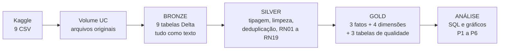

| Notebook (código-fonte) | Faz | Execução na nuvem, com saídas | Tempo |
|---|---|---|---:|
| [`01_coleta_bronze`](notebooks/01_coleta_bronze.py) | Cria esquemas e volume, baixa os CSV, grava a bronze e confere as contagens | [ver resultado](notebooks/executados/01_coleta_bronze.ipynb) | 78 s |
| [`02_transformacao_silver`](notebooks/02_transformacao_silver.py) | Tipa, limpa, deduplica, concilia geolocalização e aplica as regras de negócio | [ver resultado](notebooks/executados/02_transformacao_silver.ipynb) | 51 s |
| [`03_modelo_gold`](notebooks/03_modelo_gold.py) | Constrói o modelo dimensional, declara chaves e grava o catálogo no Unity Catalog | [ver resultado](notebooks/executados/03_modelo_gold.ipynb) | 159 s |
| [`04_qualidade_dados`](notebooks/04_qualidade_dados.py) | Avalia cada atributo e 21 regras de qualidade | [ver resultado](notebooks/executados/04_qualidade_dados.ipynb) | 53 s |
| [`05_analise_perguntas`](notebooks/05_analise_perguntas.py) | Responde P1 a P6 em SQL e gera os gráficos | [ver resultado](notebooks/executados/05_analise_perguntas.ipynb) | 27 s |

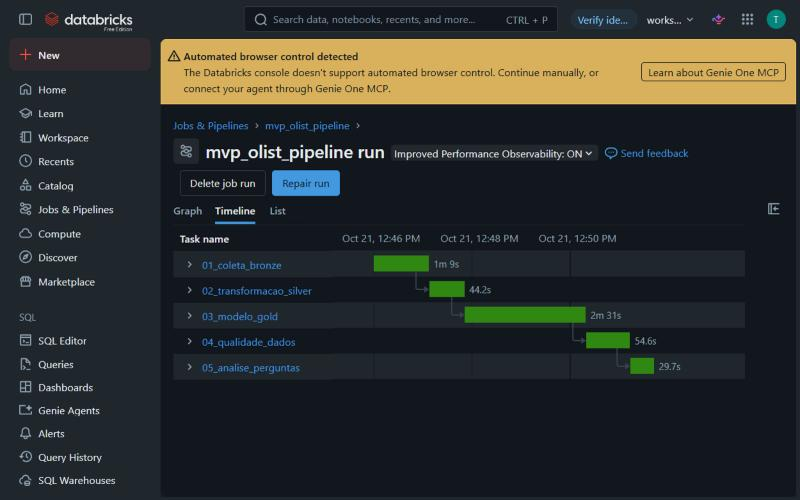

*Figura 1. Execução do job `mvp_olist_pipeline` no Databricks: as cinco tarefas em sequência, todas concluídas com sucesso.*

Os arquivos `.py` são o código-fonte no formato do Databricks, importado pelo Git folder. Os `.ipynb` em [`notebooks/executados/`](notebooks/executados/) são as mesmas execuções exportadas do job, com todas as tabelas e gráficos, para leitura direta no GitHub. Os cinco notebooks rodam como um job do Lakeflow Jobs em computação *serverless*, cada tarefa dependente da anterior ([definição](scripts/job_pipeline_olist.json)). Cada notebook termina com verificações que interrompem o job se algo sair do esperado: contagens da bronze iguais às dos arquivos, chaves únicas na silver, catálogo idêntico ao modelo na gold e integridade referencial na qualidade. O pipeline é idempotente: reexecutado, sobrescreve as tabelas e dispensa o download quando os arquivos já estão no volume.

## 4. Modelagem e Catálogo de Dados

**Esquema constelação: três tabelas fato que compartilham quatro dimensões conformadas.** A `fato_pedido` (grão de pedido) atende às seis perguntas; `fato_item_pedido` e `fato_pagamento` preservam os grãos de item e de pagamento, que não podem ser somados ao pedido sem duplicar valores. Diagrama e justificativa de cada decisão em [`catalogo/modelo_dados.md`](catalogo/modelo_dados.md).

**O Catálogo de Dados descreve os 75 atributos do modelo** com tipo, descrição, domínio esperado (mínimo e máximo ou categorias válidas), obrigatoriedade, significado do nulo e linhagem até o arquivo e a coluna de origem: [`catalogo/catalogo_dados.md`](catalogo/catalogo_dados.md). A fonte é um único arquivo, [`catalogo_dados.csv`](catalogo/catalogo_dados.csv), usado duas vezes pelo pipeline: o notebook 03 grava cada descrição como comentário de coluna no Unity Catalog, e o notebook 04 confere cada coluna contra o domínio declarado. O notebook 03 falha se o catálogo e o modelo divergirem em uma coluna que seja.

| Esquema gold no Unity Catalog | Catálogo aplicado às colunas | Linhagem registrada pela plataforma |
|---|---|---|
| 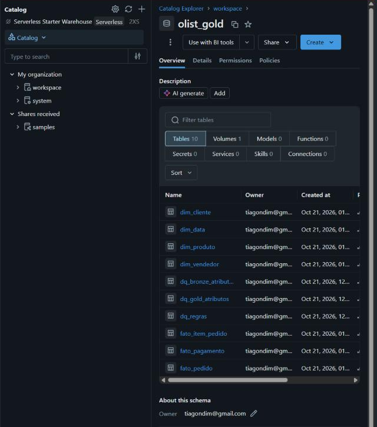 | 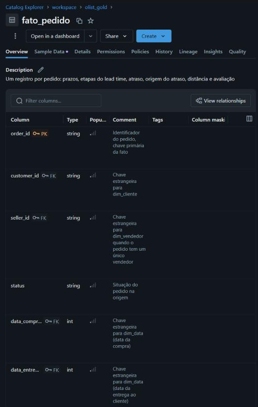 | 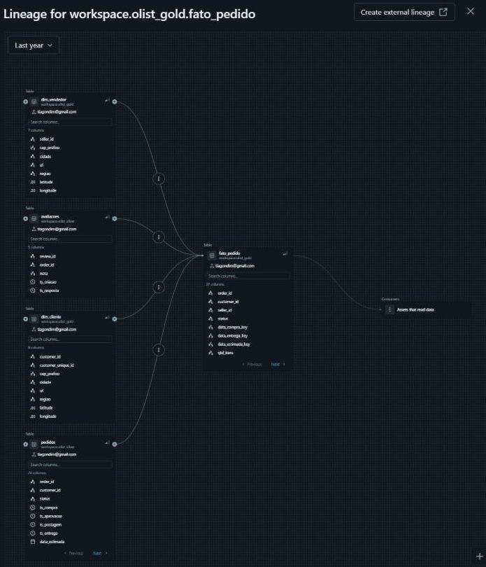 |

*Figura 2. À esquerda, as dez tabelas do esquema `olist_gold`. No centro, a `fato_pedido` com descrição da tabela, chaves primária e estrangeiras e a descrição de cada coluna, gravadas a partir do catálogo. À direita, a linhagem que o Unity Catalog registrou sozinho: a fato nasce de `silver.pedidos`, `silver.avaliacoes`, `dim_cliente` e `dim_vendedor`, como descrito no catálogo.*

## 5. Transformação e carga

As 19 regras de negócio aplicadas na transformação estão em [`catalogo/regras_de_negocio.md`](catalogo/regras_de_negocio.md), cada uma com o motivo e o notebook que a aplica. As que mais pesam na interpretação dos resultados:

| Regra | O que faz | Efeito nos resultados |
|---|---|---|
| RN04 | Atraso por data-calendário, não por carimbo de data e hora | A data prometida não tem hora; sem a regra, entregas feitas no próprio dia prometido contariam como atraso |
| RN07 | Marca pedidos com etapa de duração negativa (1.373 entregues, 1,4%) | Esses pedidos saem da decomposição do lead time, mas continuam nas taxas de atraso |
| RN08 e RN09 | Postagem tardia = postagem depois do maior prazo-limite de envio dos itens; atraso com postagem tardia é atribuído ao vendedor | Atribui ao vendedor todo atraso de pedido postado tarde, mesmo quando o transporte também demorou. Superestima o vendedor e, portanto, torna a refutação de H1 conservadora |
| RN10 | Uma avaliação por pedido (547 pedidos tinham mais de uma; 551 linhas removidas) | Garante a junção um-para-um entre avaliação e pedido |
| RN12 e RN13 | Descarta 42 pontos de geolocalização fora do Brasil e usa a mediana por prefixo de CEP | Distâncias sem pontos espúrios, como coordenadas na Europa |
| RN14 | Rota e distância só para pedidos de um único vendedor (98,7%) | Pedidos com vários vendedores não têm origem única |

**Conciliação de conjuntos.** A junção entre geolocalização (1.000.163 pontos) e cadastros reduz cada prefixo de CEP a um ponto: dos 14.994 prefixos usados por clientes, 279 clientes ficaram sem coordenada (0,28%). Pedidos e itens são conciliados por `order_id`, com verificação de que nenhum pedido se perde na junção.

## 6. Resultados

### 6.1 Qualidade dos dados: o conjunto é íntegro, e as falhas encontradas estão isoladas e tratadas

A qualidade foi avaliada em três níveis, todos gravados em tabelas consultáveis na gold: as 52 colunas da origem, os 75 atributos do modelo contra o catálogo e 21 regras. Resultado completo, com cada consulta, em [`notebooks/executados/04_qualidade_dados.ipynb`](notebooks/executados/04_qualidade_dados.ipynb).

**Nenhuma regra bloqueante foi violada.** Não há chave duplicada nas fatos nem registro órfão: zero itens sem pedido, sem produto ou sem vendedor; zero pedidos sem cliente; zero pagamentos ou avaliações sem pedido.

| Dimensão | Achado | Volume | Tratamento |
|---|---|---:|---|
| Completude | Comentário de avaliação vazio | 58,7% (título 88,3%) | Atributo fora do escopo; não usado |
| Completude | Pedido sem data de entrega (não entregue) | 2.965 (3,0%) | Fora do universo de entrega (RN01) |
| Completude | Produto sem categoria | 610 (1,9%) | Categoria `sem_categoria` (RN16) |
| Completude | Pedido sem nenhum item (cancelado ou indisponível) | 775 | Mantido; não entra em análise de entrega |
| Completude | Pedido entregue sem avaliação | 646 (0,7%) | Excluído só da P5 |
| Completude | Pedido de vendedor único sem distância (prefixo sem coordenada) | 471 | Excluído só da análise por distância |
| Unicidade | Pedido com mais de uma avaliação | 547 pedidos, 551 linhas | Mantida a mais recente (RN10) |
| Unicidade | `review_id` repetido em pedidos diferentes | 814 | Tolerado: a chave de análise é o pedido |
| Consistência | Pedido entregue com etapa de duração negativa | 1.373 (1,4%) | Fora da decomposição do lead time (RN07) |
| Consistência | Status `delivered` sem data de entrega / data de entrega com outro status | 8 / 6 | Seguem a regra RN01 |
| Consistência | Soma dos pagamentos difere de itens mais frete em mais de R$ 1 | 249 | Pagamentos não são somados ao pedido (RN19) |
| Acurácia | Ponto de geolocalização fora do Brasil | 42 | Descartado (RN12) |
| Acurácia | Prazo-limite de envio depois de 2018 (até abril/2020) | 4 itens | Mantido; não altera taxas |
| Acurácia | Produto com peso zero; pagamento com zero parcelas ou valor zero | 4; 2; 9 | Mantidos; atributos fora das perguntas |
| Conformidade | Atraso fora da faixa esperada de ±60 dias (até 188 dias) | 113 (0,1%) | Mantidos na faixa "15 dias ou mais": são atrasos reais extremos |
| Atualidade | Última compra registrada em 17/10/2018 | 2.926 dias antes da análise | Os achados descrevem a operação de 2017 a 2018, não a atual |

### 6.2 P1 · O atraso não é crônico: quase metade dele se concentra em três meses

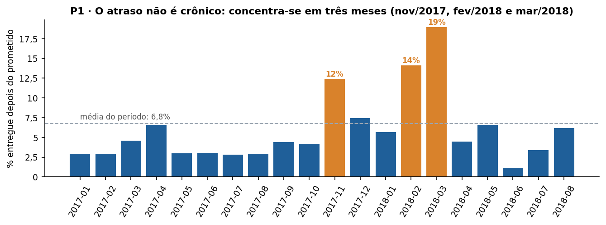

**De 96.470 pedidos entregues, 6.534 (6,8%) chegaram depois da data prometida.** Em 16 dos 20 meses a taxa ficou abaixo de 6,6%. Novembro/2017 (12,4%), fevereiro/2018 (14,1%) e março/2018 (19,0%) somam 3.158 atrasos, 48% do total, com 22% dos pedidos.

Os picos têm naturezas diferentes. Novembro/2017 é um pico de **demanda**: o volume subiu 63% sobre outubro (de 4.478 para 7.288 pedidos), no mês da Black Friday. Fevereiro e março/2018 tiveram volume estável (6.555 e 7.003 pedidos, contra 7.069 em janeiro), portanto o atraso não veio de excesso de pedidos. Uma hipótese compatível com o pico de março, não testada com estes dados, é a greve dos Correios por tempo indeterminado iniciada em 12/03/2018 ([Findect](https://findect.org.br/wp-content/uploads/2018/03/a2018m02d28-Informativo-007-FINDECT-reforça-o-chamado-aos-trabalhadores-de-todo-país-para-defesa-dos-Correios-público.pdf)).

**Implicação:** a capacidade logística deve ser planejada para picos, não para a média. A taxa média de 6,8% esconde meses em que um em cada cinco pedidos atrasou.

*Ressalva:* os meses finais (julho e agosto/2018) estão censurados à direita. Pedidos ainda em trânsito na data de extração não entram no universo, o que tende a subestimar o atraso desses meses. O prazo prometido médio caiu de 24 para 15,8 dias em agosto/2018, um risco a monitorar.

### 6.3 P2 · O atraso nasce no transporte: H1 refutada

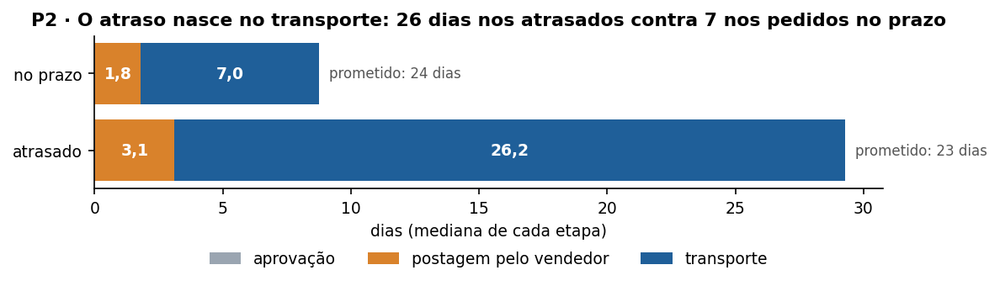

| Origem do atraso (RN09) | Pedidos atrasados | Participação |
|---|---:|---:|
| Transporte (vendedor postou no prazo) | 4.695 | 72,1% |
| Vendedor (postagem depois do prazo-limite) | 1.814 | 27,9% |

| Mediana em dias | Aprovação | Postagem | Transporte | Lead time total | Prometido |
|---|---:|---:|---:|---:|---:|
| Pedidos atrasados (6.510) | 0,02 | 3,07 | 26,2 | 31,3 | 23 |
| Pedidos no prazo (88.587) | 0,01 | 1,79 | 7,0 | 9,9 | 24 |

**H1 é refutada.** Só 27,9% dos atrasos têm origem no vendedor, abaixo do limiar de 50% fixado antes da análise. E a regra RN09 é deliberadamente favorável ao vendedor como culpado: atribui a ele todo atraso de pedido postado tarde, mesmo quando o transporte também demorou.

**A etapa que se alonga é o transporte:** 3,7 vezes mais longo nos pedidos atrasados (26,2 contra 7,0 dias), enquanto a postagem passa de 1,8 para 3,1 dias. O prazo prometido é praticamente igual nos dois grupos (23 e 24 dias). Os pedidos atrasados, portanto, não receberam promessas mais apertadas: receberam um transporte muito mais lento.

**A folga absorve a maior parte das postagens tardias.** 7,8% dos pedidos entregues no prazo também foram postados depois do limite. Das 8.697 postagens tardias, só 21% viraram atraso para o cliente. Mesmo que todos os vendedores postassem em dia, a taxa de atraso cairia no máximo 1,9 ponto percentual, de 6,8% para 4,9%; o transporte responde pelos outros 4,9 pontos.

### 6.4 P3 · SP→RJ é a rota crítica, e o atraso cresce com a distância

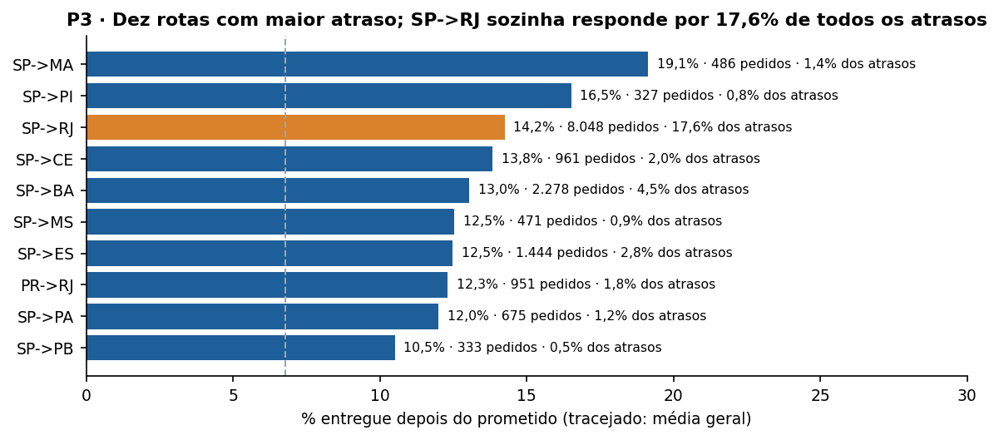

**38 rotas têm pelo menos 300 pedidos; as dez piores concentram 33,7% dos atrasos.** Nove das dez saem de São Paulo, que é a origem de 71% dos pedidos. As maiores taxas estão nas rotas para o Nordeste (SP→MA 19,1%, SP→PI 16,5%, SP→CE 13,8%), mas são rotas de volume baixo.

**A rota que mais pesa é SP→RJ:** 14,2% de atraso sobre 8.048 pedidos, ou 17,6% de todos os atrasos de pedidos de vendedor único. É a combinação de taxa duas vezes acima da média com volume alto, e por isso o primeiro alvo de renegociação de transportadora.

| Distância vendedor→cliente | Pedidos | Taxa de atraso | Transporte mediano | Prometido mediano |
|---|---:|---:|---:|---:|
| até 100 km | 17.694 | 4,5% | 2,1 dias | 15 dias |
| 100 a 500 km | 36.462 | 6,2% | 6,5 dias | 23 dias |
| 500 a 1.000 km | 25.389 | 7,2% | 8,8 dias | 26 dias |
| 1.000 a 2.000 km | 9.608 | 9,6% | 12,3 dias | 30 dias |
| 2.000 km ou mais | 5.571 | 12,1% | 14,8 dias | 34 dias |

A taxa de atraso cresce com a distância: 2,7 vezes entre a primeira e a última faixa. O prazo prometido cresce 2,3 vezes, mas o transporte mediano cresce 7 vezes. A promessa acompanha a distância, mas não a variabilidade do transporte longo.

### 6.5 P4 · A promessa não está calibrada: folgada demais no Norte e insuficiente no Nordeste e no Rio

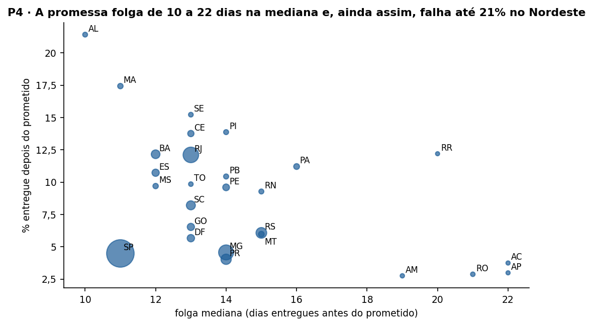

**Na mediana, todo pedido chega antes do prometido em todas as UFs:** de 10 a 22 dias antes. Ainda assim, a taxa de atraso varia de 2,8% (AM) a 21,4% (AL). A folga mediana não protege contra o atraso porque o problema está na cauda da distribuição, não no centro.

| Grupo | UFs | Folga mediana | Taxa de atraso | Leitura |
|---|---|---:|---:|---|
| Promessa folgada demais | AC, AP, RO, AM | 19 a 22 dias | 2,8% a 3,8% | Prazos de 38 a 48 dias para entregas que levam 18 a 26. Hipótese, não testável aqui: promessa longa demais reduz conversão |
| Promessa violada com frequência | AL, MA, SE, PI, CE | 10 a 14 dias | 13,8% a 21,4% | A cauda do transporte para o Nordeste supera a folga |
| Maior volume de atrasos | RJ | 13 dias | 12,1% | 12.350 pedidos, cerca de 1.500 atrasos (23% do total) |
| Referência | SP | 11 dias | 4,5% | Menor folga do país e atraso baixo: rotas curtas e previsíveis |

**Implicação:** em vez de uma folga fixa por região, o prazo deveria ser calculado por rota a partir de um percentil alto do tempo de transporte observado (por exemplo, o percentil 90). Isso encurta a promessa no Norte e a protege no Nordeste e no Rio.

### 6.6 P5 · A partir do quarto dia de atraso, dois em cada três clientes avaliam mal

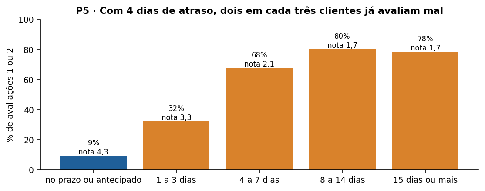

| Faixa de atraso | Pedidos avaliados | Nota média | Avaliação 1 ou 2 | Risco relativo |
|---|---:|---:|---:|---:|
| No prazo ou antecipado | 89.443 | 4,29 | 9,3% | referência |
| 1 a 3 dias | 1.852 | 3,29 | 32,1% | 3,5 vezes |
| 4 a 7 dias | 1.748 | 2,10 | 67,7% | 7,3 vezes |
| 8 a 14 dias | 1.446 | 1,67 | 80,2% | 8,6 vezes |
| 15 dias ou mais | 1.335 | 1,72 | 78,4% | 8,5 vezes |

**A insatisfação dispara entre o primeiro e o quarto dia e satura depois do oitavo.** A nota média cai de 4,3 para 2,1 já na faixa de 4 a 7 dias; acima de 8 dias, quatro em cada cinco clientes avaliam mal, e mais dias de atraso não pioram a nota.

**Os pedidos atrasados, 6,7% dos avaliados, geram 32% das avaliações ruins** (3.983 de 12.272). Se esses pedidos tivessem a taxa de avaliação ruim dos pedidos no prazo, haveria cerca de 3.400 avaliações ruins a menos, 28% do total. O dado é observacional: mostra associação forte, não prova que eliminar o atraso eliminaria essas avaliações.

**Implicação:** o gatilho de ação deve ser a *previsão* de atraso, antes do primeiro dia. Quando a entrega chega ao quarto dia de atraso, a avaliação ruim já é o resultado mais provável.

### 6.7 P6 · Um quarto dos vendedores gera 80% das postagens tardias

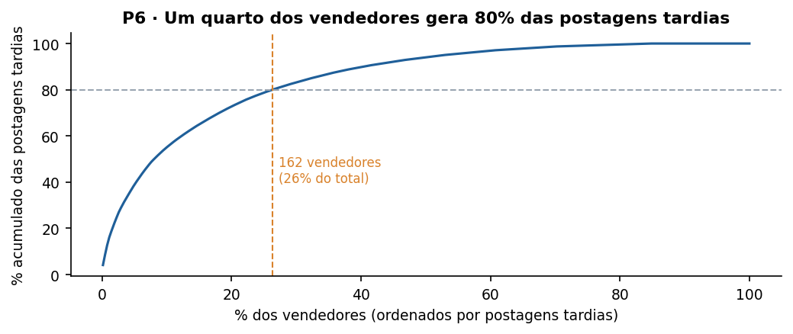

**Entre os 615 vendedores com pelo menos 30 pedidos, 162 (26%) respondem por 80% das 6.963 postagens tardias.** A concentração é real, mas menor que a regra 80/20 sugeriria. O maior ofensor postou tarde 288 de 963 pedidos (29,9%), e apenas 9,2% dos pedidos dele chegaram atrasados ao cliente, o que confirma que a folga absorve a maior parte da postagem tardia.

**Implicação:** um programa de desempenho focado nesses 162 vendedores é viável e bem delimitado. Pelo resultado da P2, porém, o ganho máximo de pontualidade é de 1,9 ponto percentual: é a alavanca secundária.

### 6.8 Discussão geral: o que a operação deve fazer primeiro

O MVP respondeu às seis perguntas, e as respostas convergem para uma ordem de prioridade diferente da esperada no início.

1. **Transportadora nas rotas críticas.** O transporte explica 72% dos atrasos e 4,9 dos 6,8 pontos percentuais da taxa. SP→RJ sozinha concentra 17,6% dos atrasos; as rotas de SP para o Nordeste têm as maiores taxas. Ação: acordo de nível de serviço com a transportadora nessas rotas, com transportadora alternativa onde a taxa passar de 12%.
2. **Contingência para picos.** Metade dos atrasos ocorre em três meses. Ação: capacidade extra contratada antes de novembro e plano B para paralisações do transporte, com ampliação temporária do prazo prometido quando o risco for conhecido.
3. **Promessa por rota, não por região.** A folga média esconde a cauda (P4). Ação: prazo prometido pelo percentil 90 do transporte por rota, validado em teste A/B que meça atraso e conversão.
4. **Contato proativo antes do quarto dia.** A avaliação desaba entre o primeiro e o quarto dia (P5). Ação: alerta quando a previsão de entrega ultrapassar a data prometida, com contato e eventual compensação.
5. **Programa de vendedores.** Viável (162 vendedores), mas limitado a 1,9 ponto percentual.

**Limites da evidência.** Os dados são observacionais e de 2016 a 2018. Mostram onde o atraso acontece e quanto ele se associa à avaliação ruim, mas não provam que as ações acima causariam a melhora; cada uma precisa de teste controlado. A atribuição da origem do atraso usa só a data de postagem: um pedido postado tarde que também teve transporte lento conta como atraso do vendedor, o que torna a conclusão sobre o transporte conservadora.

### 6.9 Validação independente: duas implementações, mesmos números

Os números deste README vêm do Databricks (PySpark e SQL sobre a gold). Para verificar a correção, uma segunda implementação foi escrita do zero em pandas a partir apenas das regras de negócio, sem acesso ao código dos notebooks ([`scripts/validacao_referencia.py`](scripts/validacao_referencia.py)). O script [`scripts/conciliacao.py`](scripts/conciliacao.py) compara as duas: [`evidencias/conciliacao.md`](evidencias/conciliacao.md).

**Resultado: 255 de 256 comparações dentro da tolerância e nenhuma divergência.** A comparação restante é uma diferença explicada de um pedido em P2: um pedido atrasado sem data de postagem, que o Databricks deixa sem origem e o pandas atribui ao transporte. A conciliação também cumpriu sua função na primeira rodada: apontou diferenças de 1 a 4 pedidos nas faixas de distância. A causa era o pipeline arredondar a distância para uma casa decimal antes de classificar; um pedido a 99,96 km virava 100,0 km e mudava de faixa. O arredondamento foi removido e as faixas passaram a coincidir exatamente.

## 7. Viabilidade financeira

| Item | Valor |
|---|---|
| Custo da execução no Databricks Free Edition | R$ 0 |
| Duração das cinco tarefas na última execução | 368 s (cerca de 6 minutos) |
| Volume processado | 126 MB de origem, 28 tabelas Delta |
| Custo num plano pago | ver nota abaixo |

*Nota sobre o plano pago:* a página oficial de preços do Databricks carrega os valores dinamicamente e não permitiu leitura automática. Uma fonte secundária ([OWOX, outubro/2026](https://www.owox.com/blog/articles/databricks-pricing.md)) informa US$ 0,35 por DBU para jobs *serverless* no plano Premium da AWS (leste dos EUA). O consumo de DBU do job não pôde ser medido: a tabela `system.billing.usage` existe neste workspace gratuito, mas está vazia (zero linhas, consulta feita em 21/10/2026), porque o Free Edition não fatura. Por isso o custo num plano pago fica como estimativa a fazer, não como número: bastaria rodar o mesmo job num workspace pago por uma semana e ler a tabela de faturamento. O que é possível afirmar: o job processa 126 MB em cerca de 6 minutos, e uma execução diária cabe com folga no plano gratuito. O custo só passa a pesar quando o volume crescer em ordens de grandeza.

## 8. Autoavaliação

**Quais perguntas foram respondidas?** As seis. A hipótese H1 foi refutada com folga (27,9% contra o limiar de 50%), e esse é o aprendizado principal do MVP: a intuição inicial apontava para o vendedor, os dados apontaram para o transporte. Duas respostas são parciais. Na P1, a causa dos picos de fevereiro e março de 2018 não pode ser determinada com estes dados; a greve dos Correios é só uma hipótese compatível. Na P4, a ideia de que a promessa folgada demais reduz conversão não pode ser testada, porque o conjunto só contém pedidos fechados, sem as visitas que não converteram.

**Que limitações dos dados condicionaram os resultados?** (1) Não há identificação da transportadora nem da modalidade de frete, então "transporte" é uma etapa, não um fornecedor; não dá para dizer qual transportadora falha. (2) A data de postagem é uma só por pedido, mesmo quando há vários vendedores, o que obrigou a restringir rota e vendedor aos pedidos de vendedor único (98,7%). (3) Os dados terminam em 2018 e os meses finais estão censurados. (4) A avaliação é observacional, sem grupo de controle.

**O que eu faria diferente se recomeçasse?** Definiria a origem do atraso de forma contrafactual, perguntando se o pedido ainda atrasaria caso o vendedor tivesse postado exatamente no prazo-limite, em vez da regra binária RN09. Isso separaria melhor os casos mistos. Também modelaria o tempo de transporte por rota como distribuição (percentis) desde a silver, porque a P4 mostrou que a média e a mediana escondem o problema.

**Que extensões tornariam o MVP uma solução de uso contínuo?** (1) Ingestão incremental com Auto Loader e tabelas Delta com `MERGE`, em vez de sobrescrever tudo a cada execução. (2) Job agendado diariamente, com alerta quando a taxa de atraso de uma rota passar de um limite. (3) Expectativas de qualidade declarativas (Lakeflow Declarative Pipelines) no lugar das verificações em código. (4) Um modelo preditivo de atraso por pedido, que é o que viabiliza o contato proativo da P5. (5) Um painel no Databricks SQL para o gestor de operações, com as seis respostas atualizadas. (6) Dados de transportadora, para transformar "transporte" em um fornecedor que possa ser cobrado.

## 9. Como reproduzir

1. Crie uma conta gratuita no [Databricks Free Edition](https://www.databricks.com/learn/free-edition).
2. Em **Workspace > Create > Git folder**, informe a URL deste repositório.
3. Abra `notebooks/01_coleta_bronze` e execute; depois 02, 03, 04 e 05, nesta ordem. O parâmetro `catalogo` (padrão `workspace`) define o catálogo de destino.
4. Opcional, pela linha de comando: autentique a Databricks CLI (`databricks auth login --profile olist`), crie o job com `databricks jobs create --json @scripts/job_pipeline_olist.json` e rode `python scripts/executar_e_exportar.py`, que executa o job e baixa as evidências.
5. Validação independente, local: `python scripts/validacao_referencia.py` (requer os CSV) e `python scripts/conciliacao.py`.

## Evidências

| Evidência | O que comprova |
|---|---|
| [`notebooks/executados/`](notebooks/executados/) | Os cinco notebooks executados no job do Databricks, com todas as saídas, legíveis no GitHub |
| [`evidencias/execucao_databricks/`](evidencias/execucao_databricks/) | A mesma execução no formato HTML original do Databricks (baixe e abra no navegador) |
| [`evidencias/persistencia_nuvem.md`](evidencias/persistencia_nuvem.md) | As 28 tabelas Delta no Unity Catalog, com formato, linhas e data de criação, consultadas pela API de SQL |
| [`evidencias/graficos/`](evidencias/graficos/) | Os seis gráficos, gerados no Databricks e gravados no volume `olist_gold.graficos` |
| [`evidencias/resultado_databricks.json`](evidencias/resultado_databricks.json) | Números de P1 a P6 gravados pela execução na nuvem |
| [`evidencias/conciliacao.md`](evidencias/conciliacao.md) | Comparação com a implementação independente em pandas |
| [`evidencias/capturas/`](evidencias/capturas/) | Capturas de tela do workspace: job executado, Catalog Explorer e Catálogo de Dados no Unity Catalog |

## Estrutura do repositório

```text
README.md                         este documento
LICENSE                           licença do código (MIT) e registro da licença dos dados
notebooks/                        cinco notebooks Databricks, em ordem de execução
scripts/                          job, execução e exportação, validação independente e conciliação
catalogo/                         catálogo de dados, regras de negócio e modelo
evidencias/                       execução exportada, persistência, gráficos, conciliação e capturas
```
