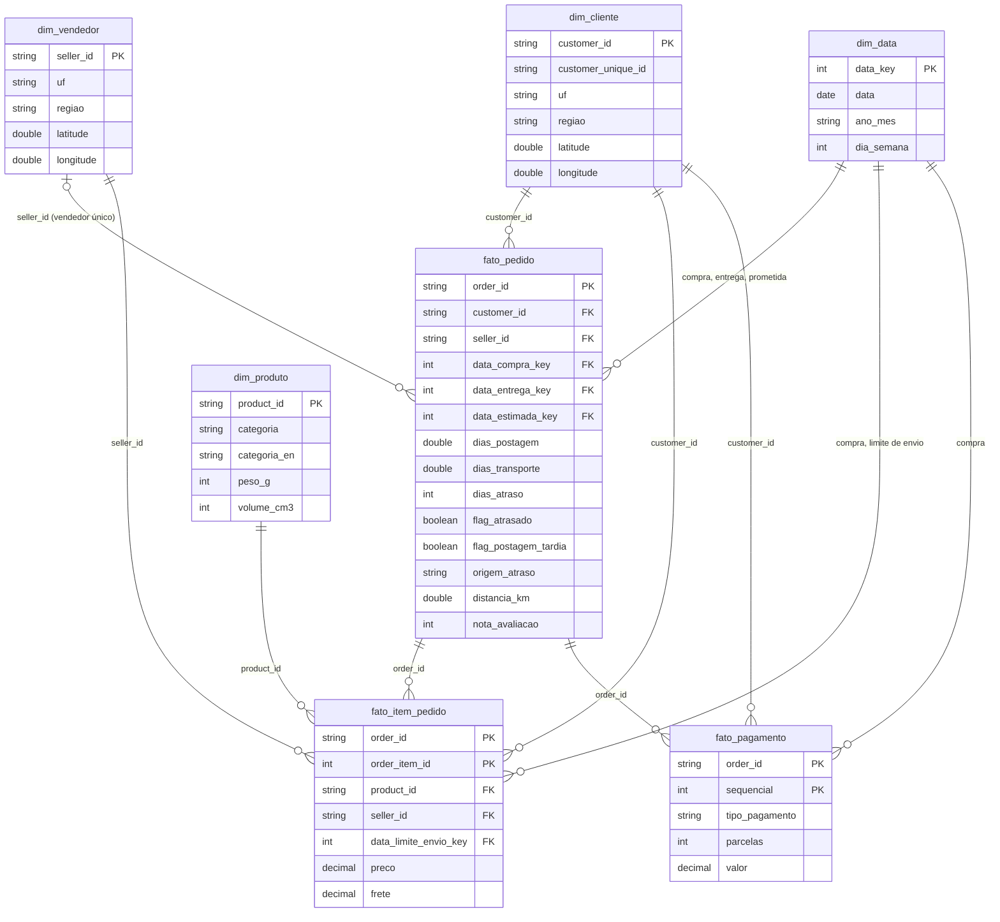

# Modelo de dados: constelação com três fatos e quatro dimensões conformadas

A camada gold segue a modelagem dimensional de Kimball. Cada fato guarda um único grão, e as dimensões são compartilhadas (conformadas) entre os fatos, o que permite cruzar pedido, item e pagamento pelos mesmos clientes, vendedores, produtos e datas.

O diagrama mostra só os atributos principais. A lista completa, com domínios e linhagem, está no [Catálogo de Dados](catalogo_dados.md).

## Decisões de modelagem

| Decisão | Alternativa descartada | Motivo |
|---|---|---|
| Fato de pedido com grão de pedido | Grão de item para tudo | Data de entrega, avaliação e atraso existem por pedido. No grão de item, um pedido com três itens contaria três atrasos e inflaria as taxas. |
| Três fatos separados (pedido, item, pagamento) | Uma fato única desnormalizada | Pagamento parcelado e voucher geram várias linhas por pedido. Juntar granularidades duplicaria valores (RN19). |
| `seller_id` na fato de pedido só quando há um vendedor | Escolher um vendedor arbitrário | 1,3% dos pedidos têm mais de um vendedor. Atribuir o atraso a um deles seria uma suposição sem base. Esses pedidos ficam fora das análises de rota e de vendedor e continuam nas demais. |
| Chaves naturais da Olist nas dimensões | Chaves substitutas sequenciais | As chaves de origem são estáveis e únicas, e o MVP não guarda histórico de mudanças (dimensões do tipo 1). Uma chave substituta acrescentaria uma junção sem ganho. |
| `dim_data` em vários papéis | Uma dimensão por papel | Uma única tabela de calendário serve compra, entrega, promessa e limite de envio, sem duplicação. |
| Esquema constelação | Snowflake (dimensões normalizadas) | Com quatro dimensões pequenas, normalizar UF e região em tabelas próprias só acrescentaria junções. |
| Coordenadas nas dimensões de cliente e vendedor | Dimensão geográfica separada | A coordenada é um atributo do local do cliente ou do vendedor; separá-la não serve a nenhuma pergunta. |

## Integridade no Unity Catalog

O notebook 03 declara 7 chaves primárias e 14 estrangeiras. No Databricks essas restrições são informativas: documentam o modelo e ajudam o otimizador, mas não bloqueiam a carga. A integridade é verificada de fato pelo notebook 04: unicidade e órfãos, com zero violações nas regras bloqueantes (ver `evidencias/execucao_databricks/04_qualidade_dados.html`).
